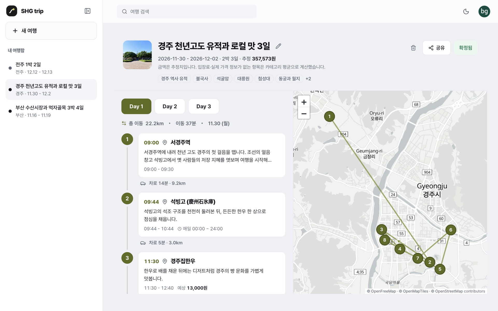
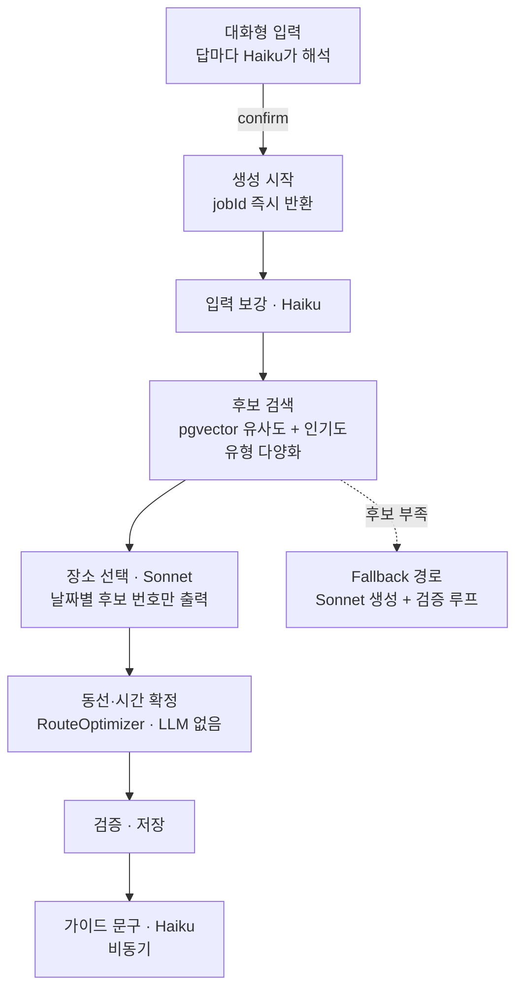

<div align="center">

# SHG trip API

여행 조건으로 장소를 고르고 동선과 시간을 확정하는 일정 생성 서버

[myshgtrip.com](https://myshgtrip.com) · [프론트엔드](https://github.com/byunggwan-kim0918/shg-trip-front) · [장소 데이터 파이프라인](docs/place-batch-pipeline.md) · [인프라](terraform/README.md)

<a href="https://myshgtrip.com">
  <picture>
    <source media="(prefers-color-scheme: dark)" srcset="docs/images/result-dark.png">
    
  </picture>
</a>

</div>

SHG trip의 Spring Boot 백엔드입니다. 대화로 받은 여행 조건을 정리하고, 장소 후보를 찾아 하루 단위 일정을 만듭니다. 국내와 일본 여행지를 지원합니다.

## 일정 생성 방식



처음에는 Sonnet이 일정 전체를 쓰고 다른 LLM 호출이 채점해 고치게 했습니다. 운영 로그에서 한 요청이 19분 동안 Sonnet 출력 65,038토큰을 쓰고 실패했고, 채점 응답은 JSON 형식도 지키지 못했습니다. 그래서 장소 정보는 DB 벡터 검색으로, 순서와 시각은 코드로 옮기고 LLM에는 후보 중에서 날짜별로 고르는 일만 남겼습니다. 바꾼 경로는 같은 날 운영 로그에서 벡터 검색부터 동선 확정까지 63초였습니다.

Sonnet에는 후보를 번호로 주고 날짜별 번호만 받습니다. 그래서 후보에 없는 장소는 일정에 들어가지 않습니다.

방문 순서와 시각은 `RouteOptimizer`가 정하고, 이 단계에서는 LLM을 부르지 않습니다. 영업시간, 휴무, 끼니 시각, 하루 이동거리, 숙소를 제약으로 두고, 이를 맞추려고 Sonnet이 고른 장소를 다른 날로 옮기거나 빼고 빈자리는 후보에서 채웁니다.

생성은 백그라운드에서 돌고 진행 상황과 완성된 날짜는 SSE로 보냅니다. 사용자당 한 번에 하나만 생성하고, 새 요청이 오면 이전 작업을 취소합니다.

## 품질 측정

저장된 일정은 채점기(`ItineraryScorer`)로 다시 채점합니다. 끼니 누락, 구간 거리 상한 초과, 출발 마감 초과처럼 일정이 성립하지 않는 위반은 따로 셉니다. 2026-10-31 기준선(평가 세트 20건)에서는 9건에 이런 위반이 하나 이상 남아 있고, Sonnet이 고른 장소가 같은 날에 남는 비율은 54%입니다.

로직을 바꿀 때는 `EvalRunner`로 기록된 선택을 현재 코드에 다시 돌려 LLM 비용 없이 기준선과 비교합니다. 지표와 위반 목록은 [docs/eval-baseline.md](docs/eval-baseline.md)에 있습니다.

## 장소 데이터

Foursquare OS Places, 한국관광공사 TourAPI, Wikidata에서 매달 장소를 받아 보강하고 임베딩합니다. 단계와 실패 기준은 [docs/place-batch-pipeline.md](docs/place-batch-pipeline.md)에 있습니다.

## 로컬 실행

```bash
./gradlew test                              # 단위 테스트, DB 불필요
docker compose up -d && ./gradlew bootRun   # PostgreSQL(pgvector), Valkey, LocalStack
```

`.env` 키와 나머지 명령은 [AGENTS.md](AGENTS.md)에 있습니다.

## 기술 스택

- [Java 21](https://openjdk.org) + [Spring Boot 3.5](https://spring.io/projects/spring-boot) – 서버
- [PostgreSQL](https://www.postgresql.org) + [pgvector](https://github.com/pgvector/pgvector) – 장소 저장, 벡터 검색
- [Valkey](https://valkey.io) – 리프레시 토큰, 요청 제한
- [Claude](https://www.anthropic.com/claude) Haiku 5.5 / Sonnet 5.5 – 입력 해석, 장소 선택, 가이드 문구
- [OpenAI Embeddings](https://platform.openai.com/docs/guides/embeddings) – 장소 임베딩
- [Flyway](https://www.red-gate.com/products/flyway/) – DB 마이그레이션
- [DuckDB](https://duckdb.org) – Foursquare 데이터 추출
- AWS ECS Fargate, RDS, ElastiCache, Step Functions – 운영
- [Terraform](https://www.terraform.io) – 인프라

## 라이선스

All rights reserved. [LICENSE.md](LICENSE.md)
